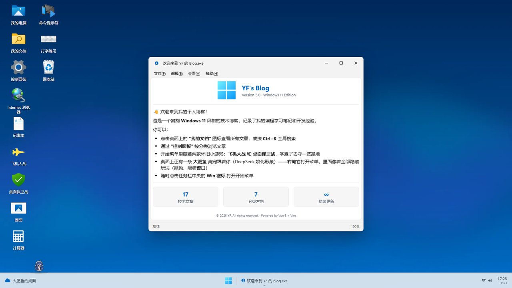
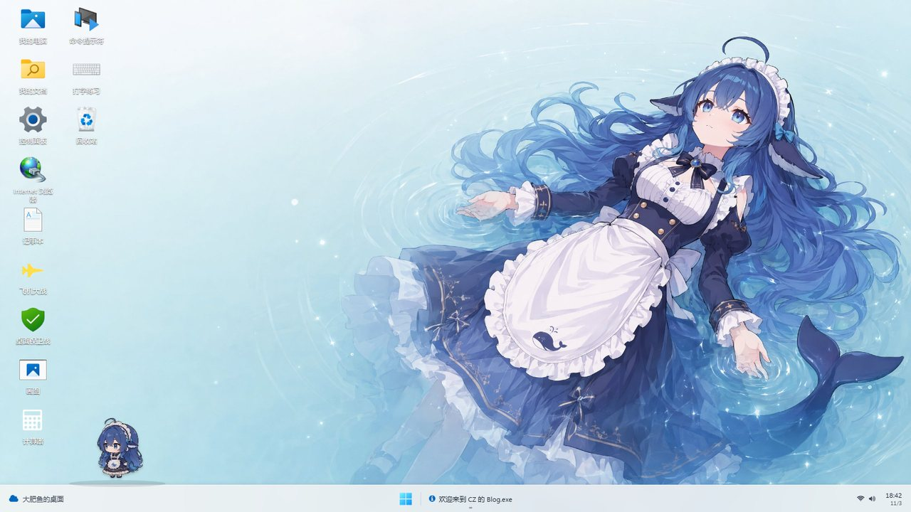
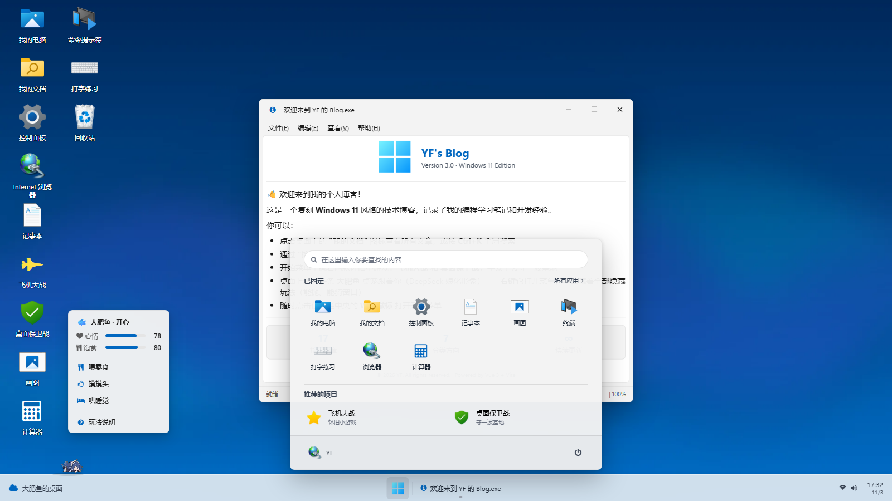

# CZ's Blog — Windows 11 风格个人技术博客

<p align="center">
  
  
  
  
  
</p>

<p align="center">
  
</p>

## 📖 项目起源

这个项目的前身是 **[YangFang1999 的 Win98 风格博客](https://github.com/YangFang1999/YangFang1999.github.io)** —— 一个复刻 Windows 98 桌面的 Vue 3 个人博客，作者用极为完整的桌面隐喻（窗口管理器、资源管理器、开始菜单、桌宠、双小游戏）构建了一个"能玩的博客"，是同类开源项目中完成度最高的实现之一。感谢原作者的出色工作与 MIT 协议的慷慨授权。

我在此基础上做了两件大事：

1. **UI 风格从 Win98 整体迁移到 Windows 11** —— 任务栏居中 + 毛玻璃、亚克力开始菜单、圆角窗口与扁平按钮、浅色右键菜单，全站（含文章页、游戏、计算器、画图、终端、查找、评论面板）统一 Fluent Design 观感；
2. **桌宠从 QQ 企鹅换成了"大肥鱼"** —— DeepSeek 的娘化看板形象，动画素材取自 DeepSeek Harness 的 **dsh-pet** 桌宠插件（详见下方致谢）。

> 🔗 **在线体验**：<https://czzzzz-rei.github.io>
>
> 💬 文章页右下角有**评论面板**（Giscus，评论存于本仓库 Discussions，GitHub 账号登录即可发言）。

## 🙏 致谢

| 致谢对象 | 贡献 |
|------|------|
| **[YangFang1999](https://github.com/YangFang1999)** | 原项目作者。Win98 桌面博客的全部基础架构——窗口系统、资源管理器、双游戏引擎、终端、屏保、文章体系——均出自其手，本项目是在这些肩膀上的二次创作 |
| **[DeepSeek](https://www.deepseek.com/) dsh-pet 插件** | "大肥鱼"桌宠的全部形象素材：106 段 VP9 透明 webm 动画（待机呼吸、点击回应、吃 Token、螃蟹走路、堆雪人……）与表情包立绘。dsh-pet 是 DeepSeek Harness（DSH 桌面客户端）的桌宠插件，本仓库 `public/pet/` 下的素材复制自其插件包，**插件的运行与配置完全不受影响** |
| **[giscus](https://giscus.app/)** | 基于 GitHub Discussions 的评论系统，零服务器成本 |

<p align="center">
  <br>
  <i>大肥鱼 —— DeepSeek 娘化看板形象（dsh-pet 插件素材）</i>
</p>

## ✨ 特色功能

### 🖥️ Windows 11 桌面模拟

- **居中任务栏** — 毛玻璃质感 + Win 徽标开始按钮，运行中窗口以下划线指示，时钟双行显示日期
- **开始菜单** — 居中亚克力面板：搜索框、固定应用网格（Win11 真实图标）、推荐项目、用户与关机
- **桌面图标** — 我的电脑、我的文档、控制面板、卡拉彼丘等，**可自由拖拽摆放**（localStorage 记住布局，「右键 → 刷新」旁一键排列）
- **桌面右键菜单 / 系统属性** — Win11 浅色圆角菜单；属性对话框展示版本、内容统计、浏览器与到访次数
- **系统托盘 + 日历** — 网络/音量图标，点击时钟弹出 Win11 风格日历（月份翻页、当日圆徽高亮）
- **屏幕保护程序** — 闲置 2 分钟自动触发经典 3D 管道屏保，任意输入退出
- **关机画面** — Win11 风格关机页（旋转环 + "It is now safe to turn off your computer"）

### 📝 技术博客

- **17 篇深度文章** — 从 Java Hello World 到 Spring Boot、Docker，每篇都是千字长文
- **7 大分类** — Java · Spring · Database · Frontend · Vue · DevOps · 随笔
- **代码高亮** — 使用 Prism.js，支持 Java、Bash、SQL 语法高亮
- **Windows 资源管理器风格浏览** — 地址栏、文件图标、向上导航按钮
- **阅读体验** — 文章信息栏（日期/分类/字数/阅读时长）、Win11 细条阅读进度条、悬浮目录（当前章节高亮）、代码一键复制、上/下一篇导航

### 🎮 内置应用程序

| 应用 | 说明 |
|------|------|
| 📁 **我的电脑** | 文件资源管理器：C 盘 = 17 篇文章、D 盘 GAMEZ = 两款游戏、控制面板与网上邻居入口 |
| 🔍 **查找：全部文件** | 全局搜索（**Ctrl+K**）：标题/分类过滤 + 正文全文检索（关键词计数 + 摘要高亮），可拖拽 |
| 📂 **我的文档** | 文章列表，按分类筛选，地址栏路径 |
| ⚙️ **控制面板** | 分类浏览入口 + 系统设置（5 种桌面主题即时切换、桌宠控制、恢复默认） |
| 🌐 **Internet 浏览器** | 跳转 GitHub 主页；**卡拉彼丘** 图标跳转 [czzzzz.dpdns.org](https://czzzzz.dpdns.org/) |
| 📝 **记事本** | 字号切换、新建/保存，内容持久化 localStorage |
| ✈️ **飞机大战** | 竖版射击：多种敌机、三阶段 Boss、道具连杀、delta-time 引擎 |
| 🛡️ **桌面保卫战** | 幸存者肉鸽：4 武器 + 5 被动、升级三选一、15:00 最终蓝屏死神 |
| 🎨 **画图** | 铅笔、橡皮、直线、矩形、油漆桶填充，20 色调色板 |
| 🔢 **计算器** | 四则运算、开方、百分比，**Win11 原生计算器风格**（蓝色功能键 + 圆角键位） |
| 🖥️ **命令提示符** | `dir`/`open`/`start`/`neofetch`/`ping`/`matrix` 彩蛋、Tab 补全、命令历史 |
| ⌨️ **打字练习** | 中文/英文/代码三模式，实时 WPM/准确率，最佳纪录持久化 |
| 💬 **评论系统** | Giscus × GitHub Discussions：每篇文章独立评论区，登录 GitHub 即可发言 |

### 🐟 桌宠"大肥鱼"

<p align="center">
  <table>
    <tr>
      <td align="center"></td>
      <td align="center"></td>
    </tr>
    <tr>
      <td align="center"><i>默认"大肥鱼壁纸"主题</i></td>
      <td align="center"><i>右键菜单（心情/饱食 + 喂零食/摸摸头/哄睡觉）</i></td>
    </tr>
  </table>
</p>

桌宠形象来自 **dsh-pet 插件的"大肥鱼"**（DeepSeek 娘化形象），106 段透明 webm 动画驱动，玩法在原企鹅基础上全部保留：

- **动画驱动**：每段动作为 16:9 VP9 透明 webm，**双缓冲交叉淡入**切换（新动画解码就位才切画面，切换零闪断）；约 20 个核心动画（待机/点击回应/拖拽/睡姿/进食/移动）页面空闲时预下载进 HTTP 缓存，触发零等待，其余 80+ 冷门动作按需加载
- **兼容降级**：启动时检测浏览器 VP9 透明支持性，夸克/UC 等国产壳内核自动降级为静态透明立绘，杜绝黑底色块
- **自主行为**：任务栏漫步（螃蟹走路/漂浮踏步/奔跑，位移与动画帧同步）、随机小动作（玩魔方/吃 Token/堆雪人……带文字的动画自动防镜像）、90 秒无互动打瞌睡
- **交互玩法**：点击随机回应（开心/害羞/傲娇/挠痒/挥手）；拖拽拎起；**甩手抛掷**（惯性飞行、撞墙弹地、摔晕冒星星、飞行中可接住）；**骑窗口**（跳上标题栏随窗口移动，甩太猛摔下来）；**回收站彩蛋**（悬停惊慌挣扎，松手逃回任务栏）
- **心情系统**：右键菜单喂零食/摸摸头/哄睡觉，心情饱食随时间与离线衰减（有保底），影响行为频率与台词语气，localStorage 持久化
- **情境台词**：根据当前打开的应用换台词（终端里"sudo 给我零食"、画图里"画我！"）

### 💬 评论系统（Giscus）

- 基于 **GitHub Discussions**，每篇文章按 id 映射独立讨论帖（strict 精确匹配，规避 hash 路由全站同 pathname 的坑）
- 评论数据全部保存在本仓库 Discussions，管理员可删除/锁定；Announcements 分类下访客只能回复不能开帖
- 面板高度锁定 + 滚动内部消化，规避 Edge 上 giscus 高频 resize 导致的窗口抖动
- GitHub OAuth 登录后自动回到原文章页

## 🛠️ 技术栈

| 技术 | 用途 |
|------|------|
| **Vue 3** | 前端框架，Composition API + `<script setup>` 语法 |
| **TypeScript** | 类型安全 |
| **Vite 5** | 构建工具 + 代码分包 |
| **Vue Router 4** | Hash 模式路由，适配 GitHub Pages |
| **TailwindCSS 3** | 原子化 CSS，Win11 配色与 Fluent 观感 |
| **Web 双缓冲视频** | 桌宠动画：双 `<video>` 交叉淡入 + `loadeddata` 就位切换 + 加载硬超时兜底 |
| **Giscus** | 评论系统（GitHub Discussions） |
| **Prism.js / Font Awesome 4.7** | 代码高亮 / 图标（npm 自托管） |
| **GitHub Actions + Pages** | push 自动构建部署，免费 HTTPS |

## 🔧 二次开发技术要点（在原项目之上的改造）

- **Win11 化策略**：原项目大量 Win98 立体浮雕样式以 Tailwind 任意值类（`shadow-[inset_-1px_-1px_#0a0a0a,...]`）散落在各视图。改造时先在 `style.css` 全局层将这些类名与 `.win95-raised/.win95-sunken/.win-btn` 重定义为 Fluent 观感（圆角 + 细边 + 浅阴影），一次性覆盖存量；再逐文件重写高频页面
- **子路径部署陷阱**：GitHub Pages 项目页发布在 `/仓库名/` 子路径，`vite build` 只改写 HTML 里的引用，**组件内写死的 `/xxx` 绝对路径原样保留**——线上全部 404。方案是 `assets-base.ts` 的 `asset()` 辅助函数统一拼接 `import.meta.env.BASE_URL`，公共资源引用一律走它
- **Tailwind JIT 边界**：运行时拼接的类名（如 `bg-[url("${x}")]`）不会被 JIT 提取，壁纸类主题改用内联 `background` 实现
- **桌宠动画工程化**：双缓冲 `<video>` 交叉淡入（复刻 dsh-pet 插件原版思路）；`loadeddata` 就位切换 + 8s 硬超时兜底 + `onEnd` 单次回调，状态机无死锁；预加载用 `fetch` 存 HTTP 缓存而非创建 video 元素（避免挤占硬件解码队列导致播放卡顿）；VP9 alpha 支持性检测 + 静态立绘降级
- **多浏览器踩坑记录**：夸克/UC 等国产壳 VP9 透明解码异常（黑块）→ 静态降级；Edge 上 giscus 高频 `resizeHeight` 造成窗口抖动 → iframe 定高锁死、忽略后续上报；GitHub Pages 子路径资源 404 → `asset()` 统一前缀

## 📂 项目结构

```
├── .github/workflows/deploy.yml  # GitHub Actions：push main 自动构建部署到 gh-pages
├── preview/                      # README 截图
└── vue-project/
    ├── public/
    │   ├── icons-win11/          # Win11 风格图标素材
    │   ├── pet/                  # 桌宠动画（webm ×106，复制自 dsh-pet 插件）+ 静态降级立绘
    │   └── wallpaper*.webp/jpg   # 桌面壁纸（Win11 光晕 / 大肥鱼）
    ├── src/
    │   ├── main.ts               # 应用入口 + 全局错误蓝屏兜底
    │   ├── App.vue               # 根组件：主题/壁纸 + 图标布局 + 窗口管理
    │   ├── assets-base.ts        # 公共资源 base 前缀辅助（子路径部署关键）
    │   ├── settings.ts           # 桌面主题（Win11 光晕/大肥鱼壁纸/纯色）
    │   ├── router/               # Hash 路由 11 条
    │   ├── views/                # 各"应用窗口"页面
    │   ├── components/
    │   │   ├── Window.vue        # 通用窗口容器（Win11 标题栏/扁平控制按钮）
    │   │   ├── Taskbar.vue       # 居中任务栏 + 亚克力开始菜单 + 日历
    │   │   ├── QQPet.vue         # 🐟 大肥鱼桌宠（双缓冲视频 + 全套交互）
    │   │   ├── FindDialog.vue    # 全局查找（Ctrl+K）
    │   │   └── ReadComments.vue  # Giscus 评论面板
    │   ├── game/                 # 飞机大战 / 桌面保卫战引擎（原项目模块）
    │   └── data/                 # 文章元数据与正文（按需动态加载）
    ├── vite.config.ts            # base '/'（根域名部署）+ polling watch
    └── package.json
```

## 🚀 本地开发

```bash
# 克隆仓库
git clone https://github.com/czzzzz-rei/czzzzz-rei.github.io.git
cd czzzzz-rei.github.io/vue-project

# 安装依赖
npm install

# 启动开发服务器
npm run dev

# 构建生产版本
npm run build
```

## 📦 部署

推送 `main` 分支自动触发 GitHub Actions 构建（`.github/workflows/deploy.yml`），产物推送到 `gh-pages` 分支发布，约 1 分钟生效。

> ⚠️ 注意：仓库即用户主页站点（`<user>.github.io`），Pages 发布在根域名，`vite.config.ts` 的 `base` 保持 `'/'`；若复刻到普通仓库（子路径部署），需改 `base` 为 `'/仓库名/'`，且组件内公共资源引用务必走 `asset()`。

## 📄 License

MIT © 2024 CZ · 原项目基于 [YangFang1999/YangFang1999.github.io](https://github.com/YangFang1999/YangFang1999.github.io)（MIT）构建
· 桌宠素材来自 DeepSeek dsh-pet 插件，版权归 DeepSeek 所有，仅作个人非商业用途

---

<p align="center">
  <i>It is now safe to turn off your computer.</i> 💾
</p>
